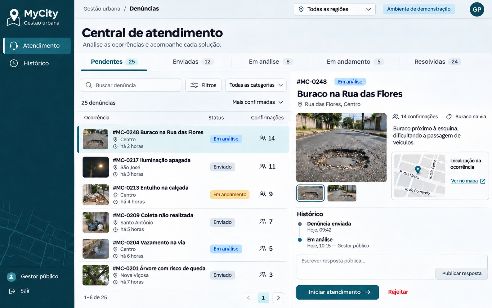

# MyCity

**Sua cidade, sua voz.**

Aplicativo de participação cidadã para registrar problemas urbanos e acompanhar o atendimento pelo município. Projeto acadêmico com Android para o cidadão e uma interface web para o gestor, desenvolvido com SDD e TDD.

[](LICENSE)
[](https://github.com/Duck1201/MyCity/actions/workflows/ci.yml)

[Demonstração da fundação](https://mycity.private-gateway.site:8080) · [Documentação](docs/readme.md) · [Plano](plan.md) · [Pendências](concerns.md) · [Como contribuir](#contribuição)

## Visão do produto

O cidadão registra uma denúncia com fotos e localização; o gestor analisa, responde e atualiza o atendimento; o cidadão acompanha o histórico e recebe avisos no app. Alertas climáticos usam cenários simulados nesta entrega.



> Conceito visual em refinamento. A imagem não representa uma interface já implementada.

## Estado atual

- [x] Monorepo TypeScript e contratos compartilhados.
- [x] Express, Prisma, PostgreSQL e Docker Compose.
- [x] Seed idempotente com dois cidadãos e um gestor.
- [x] Testes unitários, integração com banco real e componentes.
- [x] CI/CD com publicação no GHCR e deploy HTTPS na EC2.
- [ ] Login com sessão e permissões HTTP.
- [ ] Denúncias com fotos, GPS e seleção manual no mapa.
- [ ] Painel de atendimento, histórico e notificações.
- [ ] APK homologado em Android real.

Web e app exibem a marca inicial. A API expõe saúde do serviço; a validação interna de credenciais ainda não emite sessões. Resultados e limites estão em [evidências](docs/evidence/foundation.md).

## Stack

| Parte     | Tecnologias                                               |
| --------- | --------------------------------------------------------- |
| Web       | React, Vite, Tailwind CSS, shadcn/ui                      |
| Android   | React Native, Expo, StyleSheet                            |
| API       | Express, Prisma, PostgreSQL                               |
| Qualidade | TypeScript, ESLint, Prettier, Vitest, Jest/Expo           |
| Entrega   | Docker Compose, GitHub Actions, GitHub Container Registry |

O backend é um monólito modular: Identidade, Denúncias, Notificações e Alertas se comunicam por interfaces em memória. App e web acessam a API por HTTP. Não há fila nem WebSocket no MVP.

## Estrutura

```text
apps/
  api/                 # Backend e módulos de domínio
  web/                 # Interface do gestor
  mobile/              # Aplicativo do cidadão
packages/contracts/    # DTOs e validações compartilháveis
infra/                 # Proxy e configuração operacional
scripts/               # Preparação e verificações
.github/workflows/     # CI e CD
docs/                 # Especificação, decisões e evidências
refs/                  # Referências visuais
```

## Executar localmente

Requisitos: Node 24, npm 11, Docker e Docker Compose. Versões fixadas nos manifestos, `.nvmrc` e `package-lock.json`.

```bash
git clone https://github.com/Duck1201/MyCity.git
cd MyCity
npm ci
npm run setup
docker compose up -d --wait db
npm run db:migrate
npm run db:seed
docker compose up -d --build --wait api web
```

Acesse **http://localhost:8090**. A API está no mesmo host em `/api/v1/health/live` e `/api/v1/health/ready`.

`setup` cria `.env` com credenciais aleatórias somente se ele não existir. As contas são `cidadao.a@mycity.example`, `cidadao.b@mycity.example` e `gestor@mycity.example`; a senha local está em `DEMO_PASSWORD`. Seed repetido preserva IDs e senhas existentes. Nunca versionar `.env`.

Migrações e seed também podem rodar em containers:

```bash
docker compose --profile tools run --rm --build migrate
docker compose --profile tools run --rm --build seed
```

Os volumes guardam banco e fotos. Não use `docker compose down -v` em uma atualização.

## Desenvolvimento

Execute em terminais separados:

```bash
npm run dev:api
npm run dev:web
npm run dev:mobile
```

Após alterar contratos, execute `npm run build:contracts`. O perfil Expo `preview` prepara a futura distribuição APK; gerar um bundle não equivale a validar um APK instalado.

## Testes e qualidade

```bash
docker compose --profile test up -d --wait test-db
npm run check
npm run format:check
npm run security:check
npm run export:android -w @mycity/mobile
```

`check` executa lint, typecheck, todos os testes atuais e builds da API/web. Integração usa exclusivamente o banco local `mycity_test`, separado da demonstração. As regras são testadas pelas interfaces públicas; o banco sob teste é real.

## CI/CD

A CI verifica Conventional Commits, formatação, lint, tipos, testes, bundle Android e imagens Docker. Na `main`, imagens aprovadas são publicadas no GHCR com tag derivada do SHA. O CD usa essas imagens na EC2, com credenciais em secrets, migrações explícitas e verificação de saúde.

Configuração, permissões, operação e limitações: [CI/CD](docs/ci-cd.md).

## Contribuição

Use branches curtas e Pull Requests para `main`. Commits e títulos de PR seguem **Conventional Commits**, preferencialmente em inglês:

```text
feat(reports): add report creation
fix(identity): reject expired sessions
test(reports): cover cancellation conflicts
docs: clarify demo scope
chore: update development tooling
ci: validate Android bundle
```

Cada feature ou correção inclui testes de regressão. Antes de enviar, execute as verificações acima e siga [AGENTS.md](AGENTS.md). Mudanças de comportamento devem atualizar a especificação e seus critérios de aceitação.

## Licença

Licenciado sob [Apache License 2.0](LICENSE). Atribuições de componentes de terceiros estão em [NOTICE](NOTICE).

## Agentes de qualidade

Cada fase passa por Pentest Sol e Luna; QA de interface e integração complementam a revisão conforme a mudança. Os cenários de QA usam as personas fornecidas. Papéis, modelos, gatilhos e limites estão em [agents/readme.md](agents/readme.md). Os modelos são acionados pelo orquestrador Codex; a CI executa scanners/testes de forma independente.
