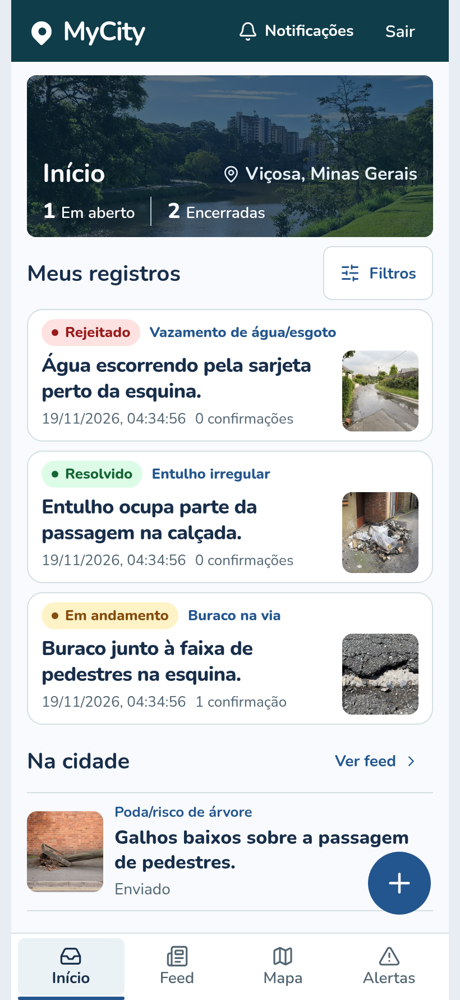
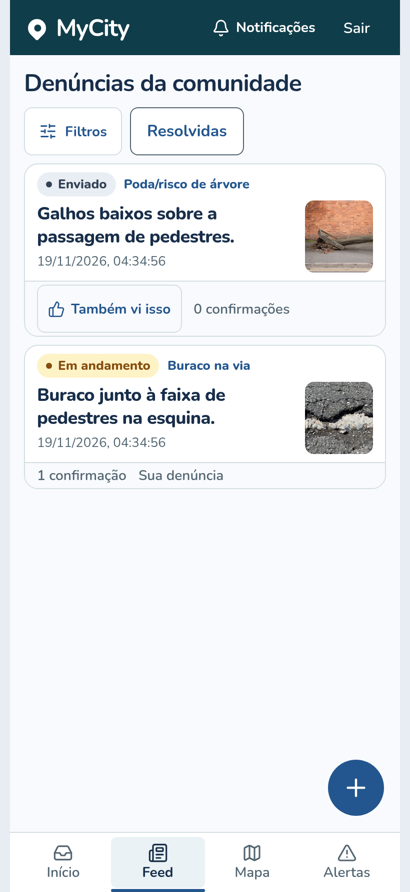

<p align="center">
  
</p>

<h1 align="center">MyCity</h1>

<p align="center"><strong>Sua cidade, sua voz</strong></p>

<p align="center">Denúncias urbanas com foto e localização, do registro ao atendimento.</p>

<p align="center">
  <a href="https://github.com/Duck1201/MyCity/actions/workflows/ci.yml"></a>
</p>

<p align="center">
  <a href="#veja-como-funciona">Capturas</a> ·
  <a href="#executar-localmente">Instalação local</a> ·
  <a href="#usar-o-app-android">Android</a> ·
  <a href="#guias">Guias</a> ·
  <a href="#referências-do-projeto">Referências</a>
</p>

## Veja como funciona

### Painel do gestor

Em **Atendimento**, o gestor filtra a fila por categoria, situação ou período. No detalhe da denúncia, pode consultar fotos, localização e histórico, responder ao relato e atualizar sua situação. O [painel da demonstração](https://mycity.private-gateway.site:8080) exige uma conta de gestor fornecida pelo responsável.


### App do cidadão

Em **Início**, o cidadão acompanha os próprios registros e pode abrir uma nova denúncia. No **Feed**, consulta as ocorrências ativas da comunidade e pode confirmar que viu o mesmo problema.

<p align="center">
  
  
</p>

As capturas mostram exemplos fictícios do seed no banco local. As telas do cidadão foram capturadas na [prévia do app no navegador](docs/runbook.md#prévia-do-cidadão-no-navegador). Os alertas climáticos são simulados.

## Executar localmente

### Com Docker

Baixe o projeto e, na raiz, execute em um terminal Bash no Linux, macOS ou WSL. Basta ter Docker com Compose.

```bash
bash scripts/docker-local.sh
```

O comando cria o `.env` se necessário, compila a API e o painel, aplica as migrações e carrega os dados fictícios. Abra o [painel local](http://localhost:8090) com a [conta de gestor](#contas-de-demonstração). Para ajustar portas, parar ou atualizar, siga o [guia do Compose local](docs/runbook.md#executar-com-docker-compose).

### Para desenvolver

Você precisa de **Git, Node.js 24.11 ou superior na linha 24, npm 11 e Docker com Compose**. Use Linux, macOS ou WSL com acesso ao Docker. A versão de Node usada na CI está em [`.nvmrc`](.nvmrc). Se já tem o checkout, comece em `npm ci` na raiz.

```bash
git clone https://github.com/Duck1201/MyCity.git
cd MyCity
npm ci
npm run setup:local
npm run dev
```

O `setup:local` cria o `.env` com senhas aleatórias se ele ainda não existir, gera o cliente Prisma, compila os contratos, inicia o PostgreSQL do Compose e aplica as migrações e o seed. Rode novamente quando precisar aplicar migrações ou carregar exemplos ausentes. Para usar outro PostgreSQL, siga o [guia de banco personalizado](docs/runbook.md#preparar-um-banco-de-desenvolvimento-personalizado).

Em desenvolvimento, confira a [saúde da API](http://localhost:3000/api/v1/health/ready). Para mudar portas, consulte o [guia de ambiente local](docs/runbook.md#ambiente-local).

### Contas de demonstração

Abra o [painel local](http://localhost:8090) com a conta de gestor e selecione **Atendimento**. Para experimentar a jornada do cidadão, use uma das contas abaixo na [prévia do app no navegador](docs/runbook.md#prévia-do-cidadão-no-navegador) com `npm run dev` em execução.

| Perfil    | CPF fictício  | Chave da senha no `.env`  |
| --------- | ------------- | ------------------------- |
| Gestor    | `00000000003` | `DEMO_MANAGER_PASSWORD`   |
| Cidadão A | `00000000001` | `DEMO_CITIZEN_A_PASSWORD` |
| Cidadão B | `00000000002` | `DEMO_CITIZEN_B_PASSWORD` |

## Usar o app Android

Baixe `mycity.apk` e o arquivo de verificação correspondente em [GitHub Releases](https://github.com/Duck1201/MyCity/releases). O APK usa a API da demonstração e requer Android 7.0 ou superior. Veja as [instruções de instalação](docs/runbook.md#baixar-o-apk-publicado).

Entre com a conta de cidadão fornecida pelo responsável pela instalação. Autorize a câmera e a localização quando usar esses recursos. Para configurar outra API, veja como [testar com a API local](docs/runbook.md#testar-com-a-api-local) ou [gerar um APK assinado](docs/runbook.md#gerar-o-apk-assinado-localmente).

## Guias

| Assunto                           | Onde começar                                                                                    |
| --------------------------------- | ----------------------------------------------------------------------------------------------- |
| Registrar ou atender uma denúncia | [Primeiros passos por perfil](docs/flows.md#primeiros-passos)                                   |
| Hospedar o MyCity                 | [Preparação do servidor](docs/deploy.md#preparar-um-servidor) e [backup](docs/deploy.md#backup) |
| Integrar ou entender o código     | [Contrato HTTP](docs/api/contract.md) e [arquitetura](docs/architecture.md)                     |
| Entender o recorte do MVP         | [Escopo](docs/scope.md) e [decisões pendentes](concerns.md)                                     |

### Referências do projeto

A pasta [`docs/references/`](docs/references/) reúne o material acadêmico original do MyCity, incluindo [escopo](docs/references/escopo-do-projeto.md), [requisitos](docs/references/requisitos.md), [personas e mapa de empatia](docs/references/personas-mapa-de-empatia.md), [diagrama](docs/references/diagrama-de-casos-de-uso.md), [casos de uso estendidos](docs/references/casos-de-uso-estendidos.md) e [wireframes](docs/references/wireframes/).

## Contribuir

Em um fork, crie uma branch curta e abra um PR para `main`. Use Conventional Commits nos commits e no título do PR. O [AGENTS.md](AGENTS.md) indica onde ficam as regras, o código e os testes de cada área. As [regras de colaboração](docs/deploy.md#configuração-no-github) detalham o fluxo do GitHub.

Encontrou uma vulnerabilidade? Use o [canal privado de segurança](SECURITY.md).

### Testes e qualidade

Com o [ambiente de desenvolvimento](#para-desenvolver) preparado no host, inicie apenas o PostgreSQL de testes e rode as verificações na raiz:

```bash
docker compose --profile test up -d --wait test-db
npm run format:check
npm run check
```

O check valida OpenAPI, lint, tipos, testes e build. A integração automatizada usa o banco dedicado `mycity_test`. Consulte a [estratégia de testes](docs/testing.md) para os ensaios manuais, as verificações do Android e a atualização das capturas deste README.

## Licença

O código do MyCity usa [Apache 2.0](LICENSE). Autores, fontes e licenças das fotos fictícias estão nos [créditos das ocorrências](apps/api/prisma/report-images/credits.json) e nos [créditos das imagens do app](apps/mobile/src/assets/creditos.txt).
