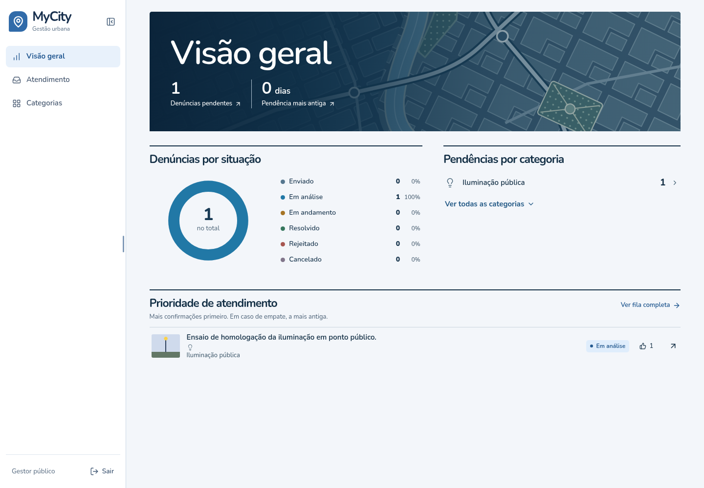

# MyCity

O cidadão registra problemas urbanos pelo app Android e acompanha o histórico. O gestor usa o painel web para analisar denúncias, responder e atualizar o atendimento. Os dois clientes usam a mesma API e o mesmo PostgreSQL. Os alertas climáticos usam cenários simulados.

[Demonstração hospedada](https://mycity.private-gateway.site:8080)




## Usar o app Android

Para usar um APK já configurado, instale-o em Android 7.0 (API 24) ou superior, conecte o aparelho à internet e entre com uma conta de cidadão fornecida pelo responsável pela instalação. Autorize a câmera e a localização ao usar esses recursos. O APK já contém a configuração do mapa e funciona com o Metro desligado.

Para distribuir seu próprio APK, prepare uma API acessível pelo celular, uma chave de assinatura e um projeto Google Cloud com faturamento habilitado. O [guia do Android](docs/runbook.md#configuração-do-android) explica como entrar no console, obter a chave do Maps, restringi-la ao seu app e testar a instalação.

## Executar localmente

Use Node 24 e npm 11. Na raiz do repositório, prepare a instalação:

```bash
npm ci
npm run setup
```

O setup gera o cliente Prisma, compila os contratos e cria o `.env` se ele ainda não existir. Confira `DATABASE_URL`. Para usar o PostgreSQL do projeto, execute `docker compose up -d --wait db`. Com o banco disponível, prepare os dados e inicie o projeto:

```bash
npm run db:migrate
npm run db:seed
npm run dev
```

Abra o painel em **http://localhost:8090**. Após entrar, a Visão geral abre os indicadores do banco local. Atendimento reúne a busca, os filtros, a exportação CSV e os detalhes; em Categorias, o gestor edita nomes e ícones e arquiva ou reativa grupos. O gestor usa o CPF `00000000003` e a senha `DEMO_MANAGER_PASSWORD` do ambiente. O seed também prepara os cidadãos com CPFs finais 01 e 02 e as respectivas senhas do ambiente. Ctrl+C encerra painel e API. Para abrir o app, execute `npm run dev:mobile` em outro terminal e conecte o celular à mesma rede do Metro. No PC, `npm run dev:mobile:web` abre a [prévia mobile](http://localhost:8093/), com o [login do cidadão](http://localhost:8093/login).

Após editar `packages/contracts` durante a sessão, execute `npm run build:contracts` para atualizar o pacote consumido pela API.

### Alterar o ambiente

- **Portas.** `WEB_PORT` define a porta do painel e `PORT` a da API (padrões 8090 e 3000). Reinicie `npm run dev` após editar o arquivo. Quem usa `dev:api` e `dev:web` separadamente deve reiniciar os dois. Reinicie o Metro se o endereço da API mudar. O app aceita `EXPO_PUBLIC_API_PORT` ou a URL completa em `EXPO_PUBLIC_API_URL`.
- **Senhas.** Edite a variável da conta e reinicie a API. As três senhas podem ter o mesmo valor no desenvolvimento local. Nas bases locais de desenvolvimento via loopback, a nova senha de uma conta habilitada revoga as sessões daquela conta. Outros destinos e contas legadas exigem [rotação explícita](docs/runbook.md#rotação-das-senhas-de-demonstração). Uma variável exportada no terminal tem precedência sobre a mesma chave no arquivo.
- **Dados.** Repetir o seed preserva registros e senhas. Para apagar os dados locais, encerre o desenvolvimento e confira o destino antes de usar `npm run db:reset`. O reset reaplica as migrações e termina sem usuários nem denúncias.

### Executar com Docker Compose

Para servir também a API e o painel compilados, encerre o Vite e use:

```bash
docker compose up -d --wait db
docker compose --profile tools run --rm --build migrate
docker compose --profile tools run --rm --build seed
docker compose up -d --build --wait api web
```

Para voltar ao desenvolvimento local, use `docker compose stop web api`. Os volumes guardam o banco e as fotos.

## Testes e qualidade

```bash
npm run lint
npm run typecheck
npm test --workspaces --if-present
npm run build
npm run format:check
```

Valide o fluxo integrado no painel local com a API, o PostgreSQL e as fotos do ambiente já em execução. A CI executa `npm run check`, incluindo OpenAPI, ferramentas e integrações HTTP. O runner automatizado de integração restringe o destino a `mycity_test`; preserve essa proteção e os dados do desenvolvimento. Use `npm run security:check` para a auditoria e `npm run export:android -w @mycity/mobile` para verificar o bundle.

## Trabalhar no projeto

O [AGENTS.md](AGENTS.md) indica a especificação, o código e os testes de cada área. O [plano](plan.md) registra as fases e [concerns.md](concerns.md) acompanha decisões pendentes. Para operar uma instalação ou recuperar dados, use o [runbook](docs/runbook.md).

Licença [Apache 2.0](LICENSE). Atribuições em [NOTICE](NOTICE).
