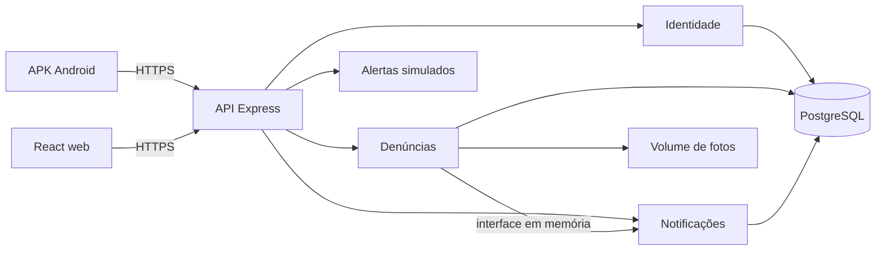

# Arquitetura

## Decisões confirmadas

Monorepo TypeScript, backend Express/Prisma em monólito modular, PostgreSQL e arquivos em volumes persistentes, React web e React Native/Expo Android. Módulos do backend comunicam-se por chamadas diretas em memória, sem rede interna entre eles. A conexão ao banco e as chamadas dos clientes à API continuam sendo conexões de rede.



O desenho representa um único processo para todos os módulos, não quatro serviços. Alertas usa uma coleção determinística servida pelo módulo.

As decisões registram os motivos para o [monólito modular](decisions/0001-modular-monorepo.md), o uso de [dados compartilhados e simulações](decisions/0002-shared-data-and-simulations.md) e a escolha de [polling](decisions/0003-polling-without-queue.md). Ao substituir uma decisão, referencie a anterior.

## Organização

```text
apps/api/src/modules/{identity,reports,notifications,alerts}/
apps/web/
apps/mobile/
packages/contracts/
docs/
refs/                    # somente imagens de referência
plan.md
concerns.md
compose.yaml             # fundação executável
```

Uma interface pública por módulo concentra as operações relevantes. Organização interna pode separar domínio, aplicação e persistência quando isso ajudar, sem criar camadas de repasse para cada função. Proibir importações de arquivos internos de outro módulo por configuração de lint quando a ferramenta for escolhida.

| Módulo       | Dono de                                 | Interface pública conceitual                                            |
| ------------ | --------------------------------------- | ----------------------------------------------------------------------- |
| Identidade   | Usuários, credenciais e sessões         | Autenticar, resolver sessão, encerrar sessão                            |
| Denúncias    | Denúncias, fotos, confirmações, eventos | Criar, consultar, confirmar, retirar, cancelar, transicionar, responder |
| Notificações | Avisos individuais e leitura            | Registrar mudança de status, listar destinatário, marcar leitura        |
| Alertas      | Cenários fictícios                      | Listar e consultar alertas simulados                                    |

Contratos compartilham DTOs e validações de entrada sem importar Prisma, segredos ou código do servidor nos clientes. Formatação de tela não decide autorização; o servidor sempre valida o ator real.

## Composição transacional

O backend fornece o banco aos módulos. O serviço de atendimento abre a transação Prisma e passa o cliente transacional à interface pública de Notificações.

Na mudança de status:

1. Resolver ator autenticado e validar permissão.
2. Dentro da transação, carregar estado/versão, validar a transição e gravar condicionalmente.
3. Criar evento de histórico em Denúncias.
4. Chamar a interface transacional de Notificações para criar um aviso ao autor, referenciado ao evento.
5. Confirmar tudo junto ou desfazer todas as gravações. Só responder sucesso após commit.

Notificações não consulta nem modifica tabelas de Denúncias; recebe apenas dados necessários do evento. Denúncias não escreve diretamente na tabela de Notificações. Um índice único por evento/destinatário impede avisos repetidos. A composição resolve dependências; não há importação circular entre módulos.

## Concorrência e idempotência

- Versão inteira da denúncia protege atualizações concorrentes. Conflito exige recarregar a representação, não repetir cegamente o comando.
- Confirmação tem unicidade de `(reportId, userId)`. PUT/DELETE representam presença/ausência e não um contador incrementado sem proteção.
- Criação usa identificador de requisição do cliente com unicidade por autor. Mesma chave/payload retorna a mesma denúncia; payload diferente é conflito.
- Transições usam versão esperada. Se o cliente perdeu a resposta, consulta o estado e o histórico antes de tentar outra mudança.
- Ordenação determinística: confirmações desc, criação asc, ID asc. Paginação não promete snapshot durante mudanças; refetch reinicia a lista e elimina IDs duplicados.

## Armazenamento de fotos

1. Autenticar o cidadão e receber o multipart em memória com limite de 16 MiB.
2. Validar quantidade, tamanho, conteúdo JPEG e dimensões. A API aplica a orientação e recodifica o JPEG.
3. Gravar os arquivos com IDs gerados pelo servidor no diretório privado da denúncia.
4. Criar denúncia/metadados/evento inicial no banco e confirmar. Se o banco falhar, remover arquivos preparados quando possível.
5. Servir fotos somente quando os metadados estiverem vinculados a uma denúncia visível ao solicitante.
6. Tratar resíduos de interrupção com limpeza de staging e reconciliação de arquivos órfãos, respeitando uma margem de tempo para uploads em andamento.

Banco e arquivos não compartilham transação. A limpeza é manutenção local explícita; não exige fila. O [runbook](runbook.md#reconciliação-offline-das-fotos) descreve o inventário e a remoção de órfãos com mais de 24 horas. A etapa 6 inclui a prova de orientação e legibilidade no aparelho.

## Integrações e ciclo de vida

GPS, câmera e galeria são capacidades reais do Android. O app usa Google Maps no Android. A geocodificação foi adiada. Meteorologia é simulada por escolha do produto. Nunca substituir silenciosamente GPS real por coordenadas de seed.

Polling pertence ao ciclo de vida da tela: cinco segundos, uma requisição ativa, pausa em background e consulta ao retornar. Não há fila, push ou WebSocket. Estado stale deve ser indicado sem apagar dados válidos.

## Implantação

Compose define web, API e PostgreSQL, com volumes distintos para banco/fotos. Somente a entrada HTTP(S) necessária será exposta publicamente; conexão do banco fica na rede de containers. Proxy/HTTPS devem se adaptar ao servidor existente (C09), sem presumir instalação ou portas disponíveis.

Migrações e seed são passos explícitos, sem reset automático. Readiness verifica dependências; liveness só indica processo vivo. Backup precisa preservar correspondência entre banco e arquivos. APK usa URL HTTPS pública, não nome interno de serviço do Compose.

## Limitações

Bibliotecas base, versões e runners estão fixados no lockfile; transporte de sessão e mapas permanecem em concerns. Não adicionar serviços separados, Redis ou event bus apenas para reproduzir um desenho arquitetural.
