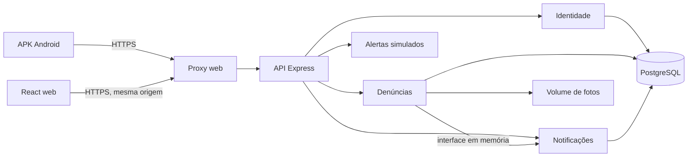

# Arquitetura

## Decisões confirmadas

Monorepo TypeScript, backend Express/Prisma em monólito modular, PostgreSQL e arquivos em volumes persistentes, React web e React Native/Expo Android. Módulos do backend comunicam-se por chamadas diretas em memória, sem rede interna entre eles. A conexão ao banco e as chamadas dos clientes à API continuam sendo conexões de rede.



Todos os módulos executam no mesmo processo da API. Alertas usa uma coleção determinística servida pelo módulo.

As decisões registram os motivos para o [monólito modular](decisions/0001-modular-monorepo.md), o uso de [dados compartilhados e simulações](decisions/0002-shared-data-and-simulations.md) e a escolha de [polling](decisions/0003-polling-without-queue.md). Ao substituir uma decisão, referencie a anterior.

## Organização

```text
apps/api/src/modules/{identity,reports,notifications,alerts}/
apps/web/
apps/mobile/
packages/contracts/
docs/                    # especificação, operação e referências acadêmicas (com wireframes)
plan.md
concerns.md
compose.yaml             # desenvolvimento e execução local
deploy/                  # compose, proxies e script de publicação genéricos
```

Cada módulo expõe suas operações a outros módulos pelo `index.ts`. O [ESLint](../eslint.config.js) restringe importações internas entre módulos e impede que clientes e contratos importem infraestrutura do servidor.

| Módulo       | Dono de                                              | Interface pública conceitual                                                               |
| ------------ | ---------------------------------------------------- | ------------------------------------------------------------------------------------------ |
| Identidade   | Usuários, credenciais, perfis e sessões              | Autenticar, resolver sessão, encerrar sessão, consultar perfis públicos                    |
| Denúncias    | Denúncias, categorias, fotos, confirmações e eventos | Criar, consultar, confirmar, retirar, cancelar, transicionar, responder e gerir categorias |
| Notificações | Avisos individuais e leitura                         | Registrar mudança de status, listar destinatário, marcar leitura                           |
| Alertas      | Cenários fictícios                                   | Listar e consultar alertas simulados                                                       |

Contratos compartilham DTOs e validações de entrada sem importar Prisma, segredos ou código do servidor nos clientes. Formatação de tela não decide autorização; o servidor sempre valida o ator real.

## Composição transacional

O backend fornece o banco aos módulos. O serviço de atendimento abre a transação Prisma e passa o cliente transacional à interface pública de Notificações.

Na mudança de status:

1. Resolver ator autenticado e validar permissão.
2. Dentro da transação, bloquear a linha da denúncia, ler estado e versão, validar a transição e atualizar a denúncia.
3. Criar evento de histórico em Denúncias.
4. Chamar a interface transacional de Notificações para criar um aviso ao autor, referenciado ao evento.
5. Confirmar tudo junto ou desfazer todas as gravações. Só responder sucesso após commit.

Denúncias registra o aviso pela interface de Notificações. A criação do aviso recebe os dados do evento e grava apenas em Notificações. Na leitura, a consulta inclui o estado anterior pelo relacionamento com o evento, sem alterar o histórico. Um índice único por evento e destinatário impede avisos repetidos.

## Concorrência e idempotência

- Versão inteira da denúncia protege atualizações concorrentes. Conflito exige recarregar a representação, não repetir cegamente o comando.
- Confirmação tem unicidade de `(reportId, userId)`. PUT/DELETE representam presença/ausência e não um contador incrementado sem proteção.
- Criação usa identificador de requisição do cliente com unicidade por autor. Respostas do gestor têm chave própria por denúncia e gestor. Reenviar a mesma chave com o mesmo conteúdo retorna o registro existente. Alterar o conteúdo com a mesma chave gera conflito.
- Transições usam versão esperada. Se o cliente perdeu a resposta, consulta o estado e o histórico antes de tentar outra mudança.
- Na fila de gestão, a ordenação por prioridade coloca denúncias ativas primeiro, por confirmações decrescentes e antiguidade. As encerradas vêm depois, das mais recentes às mais antigas. O ID desempata registros equivalentes. A fila usa páginas numeradas, enquanto as listas comunitárias usam cursor. A consistência da consulta individual não congela o conjunto entre requisições.

## Armazenamento de fotos

1. Autenticar e autorizar o cidadão antes de receber o multipart em memória com limite de 16 MiB.
2. Validar uma a três fotos JPEG, até 5 MiB por foto e maior lado de até 1.600 px. A API aplica a orientação e recodifica o JPEG.
3. Gravar os arquivos com IDs gerados pelo servidor no diretório privado da denúncia.
4. Criar denúncia, metadados e evento inicial na mesma transação. Se o resultado do commit for incerto, consultar o banco antes de remover os arquivos preparados.
5. Servir fotos somente quando os metadados estiverem vinculados a uma denúncia visível ao solicitante.
6. Reconciliar offline os diretórios órfãos remanescentes de interrupções, respeitando a idade mínima dos arquivos.

Banco e arquivos não compartilham transação. O [runbook](deploy.md#reconciliar-fotos-órfãs) descreve a manutenção offline e a idade mínima de 24 horas para os diretórios. A [matriz de aceite](testing.md#aceite-por-critério) registra o ensaio de orientação e reconhecimento do objeto fotografado.

## Integrações e ciclo de vida

O Android usa GPS, câmera, galeria e Google Maps. A geocodificação foi adiada. Meteorologia é simulada por escolha do produto. A sessão usa cookie no painel e Bearer no Android.

As telas com polling consultam a cada cinco segundos, com uma requisição ativa por consulta. O Android pausa em segundo plano e o navegador deixa de consultar enquanto a aba está oculta. Ambos consultam ao voltar. Falhas transitórias podem manter o último resultado válido. Notificações são lidas pelo próprio cliente, sem fila, push ou WebSocket.

## Carregamento do painel

Cada seção do painel é um arquivo separado. Depois que a sessão é confirmada, o painel baixa todos esses arquivos em segundo plano. Enquanto o gestor está em outra seção, ele também pré-carrega a fila padrão e o catálogo no cache de memória da sessão (`useWarmUp` em `use-live-query.ts`), com a mesma chave que a fila usa (`queue-endpoint.ts`). Assim, abrir **Atendimento** mostra a fila na hora e só revalida. O motivo é a distância: do Brasil até o servidor da demonstração, cada ida e volta leva cerca de 145 ms, enquanto a API responde em poucos milissegundos.

## Implantação

O Compose local oferece PostgreSQL e também pode executar os builds de web e API. O Compose de implantação mantém PostgreSQL e API na rede de containers. O HTTPS passa pelo Caddy e chega ao Nginx do painel, que encaminha `/api` ao Express. O Caddy comprime as respostas; o Nginx marca como imutáveis os arquivos com hash de `/assets/` e faz o navegador revalidar o `index.html` a cada visita, para um deploy novo valer na hora. Banco e fotos usam volumes distintos. Consulte [hospedagem própria](deploy.md#preparar-um-servidor) e [CI/CD da demonstração](deploy.md).

Migrações e seed são passos explícitos. O runtime hospedado usa um papel PostgreSQL restrito. A prontidão consulta a tabela de usuários do banco e a liveness verifica o processo. O backup precisa preservar os vínculos entre banco e arquivos. O APK de distribuição usa uma origem HTTPS acessível ao aparelho com o sufixo `/api/v1`.

Os limites da entrega estão no [escopo](scope.md) e as pendências no [registro de decisões](../concerns.md).
