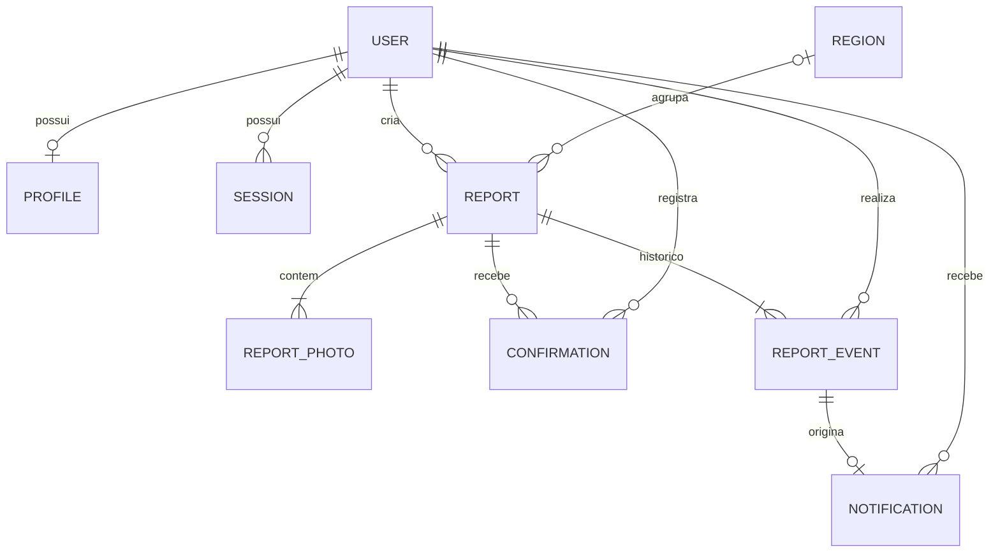

# Modelo de dados

O banco persiste identidade, sessões, perfis fictícios, denúncias, fotos ordenadas e o histórico de criação, mudanças de status e respostas. Cada mudança de status também cria um aviso para o autor. Os campos do Prisma usam camelCase e as colunas do PostgreSQL usam snake_case. O [schema executável](../apps/api/prisma/schema.prisma) contém os tipos, relações e índices atuais.

## Entidades implementadas

| Entidade / módulo           | Campos principais                                                                                                                                            | Regras                                                                                                                                                  |
| --------------------------- | ------------------------------------------------------------------------------------------------------------------------------------------------------------ | ------------------------------------------------------------------------------------------------------------------------------------------------------- |
| User / Identidade           | id, cpf, password, role, loginEnabled, createdAt, modifiedAt                                                                                                 | CPF único com 11 dígitos ASCII. A senha é um hash scrypt. Contas legadas exigem rotação antes do login HTTP.                                            |
| Profile / Identidade        | userId, name, photoUrl, createdAt, modifiedAt                                                                                                                | Perfil fictício provisionado junto das contas. A imagem JPEG pequena é devolvida como data URL nas denúncias identificadas.                             |
| Session / Identidade        | tokenHash, userId, credentialHash, transport, expiresAt, createdAt                                                                                           | Token opaco vinculado à credencial usada na emissão. Expira em 24 horas. Logout revoga a sessão.                                                        |
| Report / Denúncias          | id, authorId, showIdentity, category, description, latitude, longitude, locationSource, status, version, clientRequestId, requestHash, createdAt, modifiedAt | Autor interno obrigatório, autorização explícita para exibir o perfil, coordenadas válidas e status inicial SENT. A chave de criação é única por autor. |
| ReportPhoto / Denúncias     | id, reportId, position, byteSize, width, height                                                                                                              | Uma a três fotos JPEG privadas, com posição entre 0 e 2 e unicidade por denúncia e posição. O caminho físico deriva dos IDs gerados pelo servidor.      |
| ReportEvent / Denúncias     | id, reportId, actorId, type, fromStatus, toStatus, text, clientRequestId, createdAt                                                                          | Eventos de criação, mudança de status e resposta são imutáveis. A chave de resposta é única por denúncia e ator.                                        |
| Notification / Notificações | id, eventId, reportId, recipientId, status, readAt, createdAt, modifiedAt                                                                                    | Uma notificação por evento e destinatário. A primeira leitura define readAt.                                                                            |

A participação é representada pela relação ReportConfirmation, com chave primária composta por reportId e userId e data de criação. Cancelar é uma transição versionada que cria histórico e notifica o autor. A primeira denúncia utiliza apenas coordenadas e a origem GPS ou MANUAL. Região, endereço e geocodificação ficam para uma entrega posterior.

O módulo Alertas mantém três cenários estáticos com id, nível, título, mensagem, região ilustrativa, datas e `simulated: true`. A referência temporal da demonstração é 25/11/2026 às 12h de Brasília. A API somente consulta o catálogo; a leitura dispensa tabelas ou migrações adicionais.

## Relações previstas no MVP

Histórico e fotos têm cardinalidade mínima de um para uma denúncia publicada; banco relacional não garante essa cardinalidade apenas com FK. A criação transacional e os testes devem garanti-la. Um evento de criação ou resposta não precisa produzir notificação; mudanças de status produzem uma para o autor.

## Enums propostos

| Código       | Rótulo                   |
| ------------ | ------------------------ |
| SENT         | Enviado                  |
| UNDER_REVIEW | Em análise               |
| IN_PROGRESS  | Em andamento             |
| RESOLVED     | Resolvido                |
| REJECTED     | Rejeitado                |
| CANCELED     | Cancelado                |
| POTHOLE      | Buraco na via            |
| WASTE        | Lixo não coletado        |
| LIGHTING     | Iluminação pública       |
| DEBRIS       | Entulho irregular        |
| LEAK         | Vazamento de água/esgoto |
| TREE         | Poda/risco de árvore     |

`locationSource`: GPS ou MANUAL. Níveis de alerta: ATTENTION, ALERT, EMERGENCY. Não usar esses níveis para a prioridade das denúncias.

## Integridade e consultas

- Datas geradas no servidor, em UTC; formatar no cliente. Desempate estável por ID.
- Prioridade deriva da contagem de confirmações; não manter um segundo campo editável de prioridade.
- Índices propostos: Report(status, createdAt, id), Report(authorId, createdAt), Report(regionId, category), ReportEvent(reportId, createdAt, id), Notification(recipientId, readAt, createdAt).
- Escolher índices finais a partir das consultas reais; não declarar ganho de performance sem medição.
- Atualizar versão apenas em mudanças de estado; confirmar/remover confirmação não deve invalidar desnecessariamente o formulário de atendimento. Verificação do estado e alteração da confirmação precisam ser serializadas com o encerramento.
- FK preserva relações; exclusão em cascata não deve apagar histórico por acidente. Não haverá endpoint de exclusão física de denúncia/usuário nesta entrega.
- Cancelar altera estado, não remove dados. Retirar confirmação pode apagar a relação correspondente; manter auditoria de cada retirada não foi requisito aprovado.
- Não armazenar coordenadas contínuas ou localização atual em User. A captura pertence à ocorrência.
- A etapa 4 usa apenas coordenadas GPS ou manuais. Endereço, região e geocodificação seguem adiados.

## Dados da demonstração

O seed atual provisiona dois cidadãos, um gestor e seus perfis. A tabela `report_categories` mantém os nomes de exibição, uma chave normalizada única, o estado de arquivamento e o ícone opcional. A coluna `archived` começa em `false`; arquivar preserva os vínculos com denúncias anteriores. A coluna `icon` aceita até 20 caracteres e pode ser nula nas categorias existentes. A API valida os símbolos recebidos e o painel usa o símbolo padrão quando a categoria não tem ícone gravado. A migração converte o enum anterior em chave estrangeira, preservando os seis códigos públicos e as denúncias associadas. Novos grupos cadastrados pelo gestor têm UUID; a ausência de ocorrências não os retira do catálogo. O seed de demonstração prepara denúncias distribuídas entre os estados com fotos ilustrativas. O cidadão B confirma casos de A e vice-versa, nunca a própria denúncia. Estados avançados devem ter histórico coerente, não uma coluna de status sem os eventos correspondentes.

Segredos são fornecidos por configuração local; não documentar senha real nem fixá-la no código. Seed não redefine credenciais, não remove novas denúncias e não gera novas notificações a cada execução. Reset, se necessário, será comando distinto com alvo explícito, nunca parte do startup.

## Retenção

Preservar registros durante a demonstração. Duração posterior, descarte das imagens e eventual anonimização estão pendentes em C12. Não assumir retenção indefinida nem prometer apagamento já implementado.

## Identidade e anonimato aprovados

O checkbox começa marcado na interface; o comando de criação exige `showIdentity` explícito. Nome/foto só saem em DTOs de denúncia quando true; quando false, omitir também identificadores e links correlacionáveis do perfil para cidadãos e gestor. CPF nunca sai nesses DTOs; e-mail foi removido do modelo atual. O vínculo interno da conta permite aplicar permissões e notificar o autor. A foto de perfil é separada das 1–3 fotos da ocorrência.

## Migração da fundação

A migração `20261119040000_user_cpf_mapping` preserva IDs, hashes e created_at das três contas provisionadas. Usa transação e lock exclusivo antes do preflight; contas desconhecidas interrompem a migração e exigem mapeamento explícito. CPFs sintéticos de demonstração: 00000000001 (cidadão A), 00000000002 (cidadão B), 00000000003 (gestor). Não são comprovação de CPF real ou integração governamental. O banco verifica 11 dígitos; não verifica dígitos verificadores/existência civil.

`password` é apenas o novo nome da coluna: a implementação continua usando scrypt. `modified_at` inicia no momento da migração para os registros antigos; depois é atualizado pelo Prisma em alterações. SQL direto não dispara automaticamente @updatedAt.
