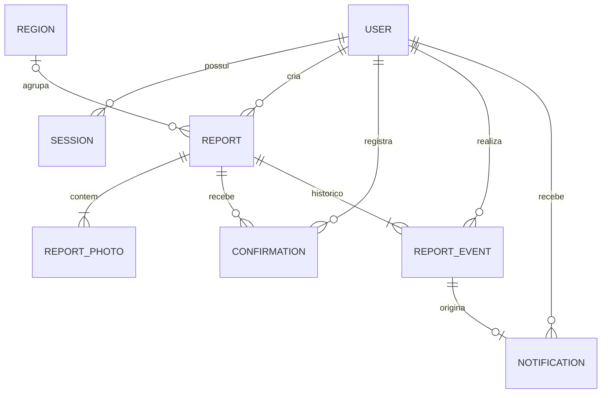

# Modelo de dados

Modelo lógico proposto para revisão. A entidade User legada (por e-mail) e Role já existem. A decisão atual é CPF/senha próprios e nenhum e-mail; a migração de User ainda será implementada antes do login HTTP. As demais entidades abaixo ainda não existem. Os nomes dos campos são propostas em inglês, enquanto rótulos da interface serão em português.

## Entidades

| Entidade / módulo           | Campos principais                                                                                                                                                                     | Restrições                                                                                                                                                   |
| --------------------------- | ------------------------------------------------------------------------------------------------------------------------------------------------------------------------------------- | ------------------------------------------------------------------------------------------------------------------------------------------------------------ |
| User / Identidade           | id, cpf, name, profilePhotoId, passwordHash, role, createdAt                                                                                                                          | CPF único normalizado em 11 dígitos; sem e-mail. Perfis fictícios pré-provisionados. Nunca retornar CPF/hash em denúncias.                                   |
| Session / Identidade        | id, userId, tokenHash, expiresAt, revokedAt                                                                                                                                           | C05 aprovado: hash do token, expiração em 24 horas e revogação imediata no logout.                                                                           |
| Report / Denúncias          | id, authorId, showIdentity, category, description, latitude, longitude, locationSource, regionId?, addressLabel?, status, version, clientRequestId, requestHash, createdAt, updatedAt | Autor interno obrigatório; showIdentity explícito; coordenadas válidas; status inicial SENT; chave de criação única por autor.                               |
| Region / Denúncias          | id, name, city?, source?                                                                                                                                                              | Estrutura provisória C03; região não é permissão. Coordenadas não garantem associação.                                                                       |
| ReportPhoto / Denúncias     | id, reportId, storageKey, position, mimeType, byteSize, width, height                                                                                                                 | Posição única por denúncia; 1–3 registros após publicação; arquivo acessível só pela aplicação.                                                              |
| Confirmation / Denúncias    | reportId, userId, createdAt                                                                                                                                                           | Chave única composta; autor não confirma a própria ocorrência.                                                                                               |
| ReportEvent / Denúncias     | id, reportId, actorId, type, fromStatus?, toStatus?, text?, clientRequestId?, requestHash?, createdAt                                                                                 | Tipos CREATED, STATUS_CHANGED, PUBLIC_REPLY; registro append-only. Rejeição exige texto. Resposta tem chave única por denúncia/ator para replay idempotente. |
| Notification / Notificações | id, recipientId, reportId, reportEventId, type, createdAt, readAt?                                                                                                                    | Unique(evento,destinatário); leitura restrita ao destinatário.                                                                                               |

Alertas simulados podem ser dados estáticos do módulo com id, nível, título, mensagem, região ilustrativa, datas e `simulated: true`. Não exigem tabela nem fluxo de emissão manual. Usar referência temporal documentada na demonstração para não apresentar alertas expirados como ativos inadvertidamente.

## Relações

Histórico e fotos têm cardinalidade mínima de um para uma denúncia publicada; banco relacional não garante essa cardinalidade apenas com FK. A criação transacional e os testes devem garanti-la. Um evento de criação ou resposta não precisa produzir notificação; mudanças de status produzem uma para o autor.

## Enums propostos

| Código       | Rótulo                   |
| ------------ | ------------------------ |
| SENT         | Enviado                  |
| UNDER_REVIEW | Em análise               |
| IN_PROGRESS  | Em andamento             |
| RESOLVED     | Resolvido                |
| REJECTED     | Rejeitado                |
| CANCELED     | Cancelado                |
| POTHOLE      | Buraco na via            |
| WASTE        | Lixo não coletado        |
| LIGHTING     | Iluminação pública       |
| DEBRIS       | Entulho irregular        |
| LEAK         | Vazamento de água/esgoto |
| TREE         | Poda/risco de árvore     |

`locationSource`: GPS ou MANUAL. Níveis de alerta: ATTENTION, ALERT, EMERGENCY. Não usar esses níveis para a prioridade das denúncias.

## Integridade e consultas

- Datas geradas no servidor, em UTC; formatar no cliente. Desempate estável por ID.
- Prioridade deriva da contagem de confirmações; não manter um segundo campo editável de prioridade.
- Índices propostos: Report(status, createdAt, id), Report(authorId, createdAt), Report(regionId, category), ReportEvent(reportId, createdAt, id), Notification(recipientId, readAt, createdAt).
- Escolher índices finais a partir das consultas reais; não declarar ganho de performance sem medição.
- Atualizar versão apenas em mudanças de estado; confirmar/remover confirmação não deve invalidar desnecessariamente o formulário de atendimento. Verificação do estado e alteração da confirmação precisam ser serializadas com o encerramento.
- FK preserva relações; exclusão em cascata não deve apagar histórico por acidente. Não haverá endpoint de exclusão física de denúncia/usuário nesta entrega.
- Cancelar altera estado, não remove dados. Retirar confirmação pode apagar a relação correspondente; manter auditoria de cada retirada não foi requisito aprovado.
- Não armazenar coordenadas contínuas ou localização atual em User. A captura pertence à ocorrência.
- Campos de endereço/região podem ser nulos na proposta C03; não fabricar endereço a partir de seed para uma denúncia real.

## Dados da demonstração

Seed repetível: dois cidadãos, um gestor, seis categorias e denúncias distribuídas entre estados, com fotos fictícias apropriadas. O cidadão B confirma casos de A e vice-versa, nunca a própria denúncia. Estados avançados devem ter histórico coerente, não uma coluna de status sem os eventos correspondentes.

Segredos são fornecidos por configuração local; não documentar senha real nem fixá-la no código. Seed não redefine credenciais, não remove novas denúncias e não gera novas notificações a cada execução. Reset, se necessário, será comando distinto com alvo explícito, nunca parte do startup.

## Retenção

Preservar registros durante a demonstração. Duração posterior, descarte das imagens e eventual anonimização estão pendentes em C12. Não assumir retenção indefinida nem prometer apagamento já implementado.

## Identidade e anonimato aprovados

O checkbox começa marcado na interface; o comando de criação exige `showIdentity` explícito. Nome/foto só saem em DTOs de denúncia quando true; quando false, omitir também identificadores e links correlacionáveis do perfil para cidadãos e gestor. CPF nunca sai nesses DTOs; e-mail será removido do modelo na migração. O vínculo interno da conta permite aplicar permissões e notificar o autor. A foto de perfil é separada das 1–3 fotos da ocorrência.
