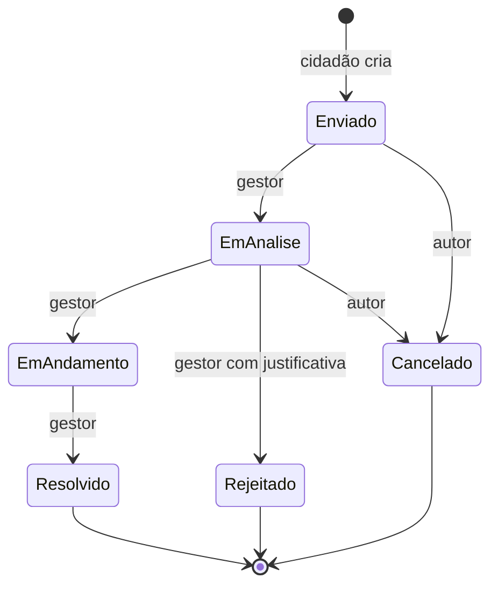

# Fluxos, estados e interfaces

Regras aprovadas estão descritas como confirmadas. A matriz de visibilidade e as políticas de encerramento abaixo são propostas para revisão (C04/C08), não decisões silenciosas de produto.

## Estados confirmados

Não existem regressões, saltos ou reabertura. Estados finais são Resolvido, Rejeitado e Cancelado. A criação registra o evento inicial; notificações são geradas nas mudanças posteriores, inclusive cancelamento, conforme o requisito de cada mudança de status.

## Jornadas

### Entrar

Usuário informa e-mail/senha, recebe sua identidade e acessa a interface do papel. Credencial inválida exibe erro genérico. Sem conexão, informar falha e permitir tentativa explícita. Sessão expirada exige novo login, sem executar ação pendente automaticamente. Mecanismo de sessão proposto no contrato HTTP (C05).

### Registrar denúncia

1. Selecionar uma das seis categorias e preencher descrição.
2. Escolher de uma a três fotos via câmera/galeria e apresentar prévias/remover antes do envio.
3. Solicitar GPS em contexto; se negado ou indisponível, oferecer mapa para selecionar o ponto.
4. Confirmar o ponto e os dados. Comprimir fotos e enviar uma operação de criação.
5. Durante o envio, impedir disparos duplicados pela interface; servidor também trata repetições.
6. No sucesso, abrir detalhes em Enviado. Na falha, manter campos e fotos enquanto o formulário estiver aberto, permitindo reenvio controlado.

Não prometer manutenção de rascunho após encerrar o processo do app; essa capacidade não foi aprovada. Não enviar ponto padrão como se fosse GPS real. Falha de geocodificação não deve ser confundida com falta de coordenadas; a política proposta está em C03.

### Consultar e confirmar

Abrir feed ou mapa, filtrar, selecionar denúncia e consultar detalhes. Outro cidadão confirma; autor não recebe ação habilitada. API repete a checagem. Atualizar contagem com resultado confirmado pelo backend; falha não mantém incremento falso. Retirada em estado final está pendente (C08).

### Atender e responder

Gestor usa lista/filtros e abre detalhes com fotos, ponto e histórico. Somente transições válidas são oferecidas. Rejeição apresenta campo obrigatório de justificativa. Uma resposta textual gera evento público, sem chat; não gera aviso de mudança de status por si só. Novas notificações específicas de resposta não foram aprovadas.

Se outro comando alterar a denúncia antes da gravação, mostrar conflito e atualizar os detalhes. Não reaplicar automaticamente uma intenção sobre o estado novo.

### Cancelar

Autor abre sua denúncia ainda Enviado/Em análise e confirma o cancelamento. Ela deixa feed/mapa e passa a constar como Cancelado no acompanhamento pessoal. Se o gestor já a moveu para Em andamento, a API rejeita; atualizar a tela e informar a razão.

### Acompanhar e ler avisos

Tela ativa consulta a cada cinco segundos, sem sobreposição, e consulta ao retornar. Lista de notificações mostra lidas/não lidas; abrir aviso acessa a denúncia e solicita marcação de leitura. Não presumir leitura quando a operação falha. Desativar polling ao desmontar tela, sair da conta ou enviar app ao segundo plano.

## Visibilidade proposta — C04

“Público” significa compartilhado entre usuários autenticados nesta proposta. Acesso sem login e dados identificáveis do autor precisam de decisão antes de implementar consultas.

| Estado       | Feed/mapa geral                             | Minhas denúncias do autor | Lista do gestor | Histórico de resolvidas |
| ------------ | ------------------------------------------- | ------------------------- | --------------- | ----------------------- |
| Enviado      | Sim                                         | Sim                       | Sim             | Não                     |
| Em análise   | Sim                                         | Sim                       | Sim             | Não                     |
| Em andamento | Sim                                         | Sim                       | Sim             | Não                     |
| Resolvido    | Somente filtro de resolvidas                | Sim                       | Sim             | Sim                     |
| Rejeitado    | Não; detalhes públicos por link autenticado | Sim                       | Sim             | Não                     |
| Cancelado    | Não; detalhes apenas autor/gestor           | Sim                       | Sim             | Não                     |

Proposta: não expor e-mail nem nome completo do cidadão; exibir “Cidadão” e informar ao próprio usuário quando ele é autor. Coordenadas e imagens seguem a permissão da denúncia, inclusive ao acessar a URL do arquivo diretamente. A matriz acima precisa ser alinhada com o sentido de transparência esperado, não apenas com o desenho das telas.

## Inventário de telas

| Plataforma | Tela                         | Estados essenciais                                                                |
| ---------- | ---------------------------- | --------------------------------------------------------------------------------- |
| App        | Login                        | Inicial, enviando, erro de credenciais, sem conexão                               |
| App        | Feed                         | Lista, filtros, vazio, carregando, falha mantendo dados                           |
| App        | Nova denúncia                | Campos, prévias, compressão, GPS negado/indisponível, seleção manual, envio/falha |
| App        | Detalhes                     | Fotos, localização, confirmações, histórico, ações conforme papel/estado          |
| App        | Mapa                         | Marcadores, filtro, seleção, vazio, erro de provedor                              |
| App        | Minhas denúncias / histórico | Status ativos/finais, cancelamento e filtros                                      |
| App        | Notificações                 | Lida/não lida, vazio, erro e navegação                                            |
| App        | Alertas                      | Três níveis simulados e detalhes; indisponibilidade de dados                      |
| App        | Perfil                       | Conta de demonstração e logout, sem edição/cadastro                               |
| Web        | Login                        | Credenciais, erro, sessão expirada                                                |
| Web        | Lista do gestor              | Filtros, prioridade, contadores, paginação e estados de consulta                  |
| Web        | Detalhes do gestor           | Fotos, localização, histórico, resposta, transições, rejeição e conflito          |

O inventário complementa os quatro wireframes; não define layout final. No frontend, refinar o conceito próprio `mycity-gestor-v2.png` com o feedback do responsável e verificar foco, rótulos, navegação, contraste e mensagens. Não depender apenas de cores para status/alerta.
