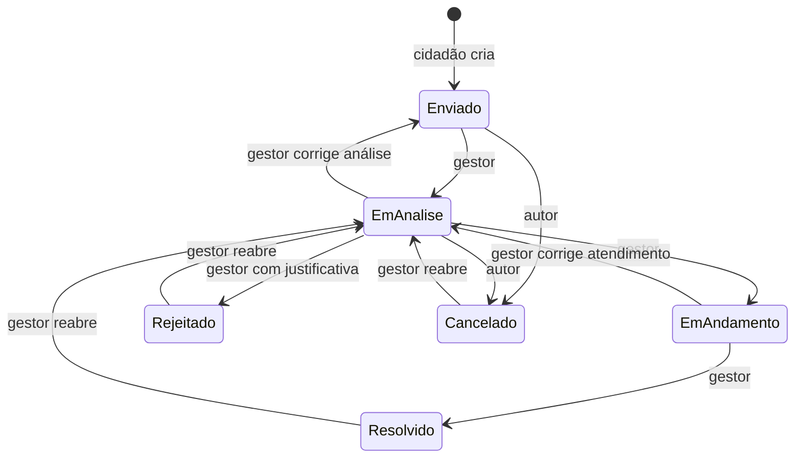

# Fluxos, estados e interfaces

O desenho, a implementação e a revisão destes fluxos seguem as [10 heurísticas de Nielsen aplicadas ao MyCity](usability.md), como boa prática aprovada para app e web.

Regras aprovadas estão descritas como confirmadas. A matriz de visibilidade e a preservação de confirmações após o encerramento foram aprovadas na etapa 4 (C04/C08).

## Primeiros passos

Use uma conta provisionada pelo operador da sua instalação. Para experimentar com contas fictícias, siga o [início rápido](../README.md#executar-localmente).

- **Cidadão.** Entre no app Android e toque no **+** no canto inferior direito. Escolha a categoria, descreva o problema, anexe fotos e confirme o ponto no mapa. Depois de enviar, acompanhe o retorno em **Meus registros** e em **Notificações**, no cabeçalho. Para consultar ocorrências de outras pessoas, abra o **Feed** ou o **Mapa**. O histórico de **Resolvidas** fica no Feed.
- **Gestor.** Entre no painel web e abra **Atendimento**. Use a busca e os filtros para encontrar uma denúncia. Abra o relato para conferir os anexos, registrar uma resposta ou mudar a situação do atendimento. Em **Categorias**, gerencie as opções que o cidadão pode escolher ao registrar uma denúncia.

## Estados confirmados

Resolvido, Rejeitado e Cancelado são estados encerrados. Só o gestor pode reabri-los em Em análise, inclusive após cancelamento pelo autor. Só é possível desfazer o último avanço de situação: uma resposta não consome essa possibilidade, mas uma correção ou reabertura impede outro recuo até um novo avanço. Corrigir ou reabrir acrescenta um evento com origem e destino e preserva o evento anterior, a justificativa e as respostas. A criação registra o evento inicial; notificações são geradas nas mudanças posteriores, inclusive cancelamento, conforme o requisito de cada mudança de status.

## Jornadas

### Entrar

Usuário informa CPF e senha próprios do MyCity, recebe sua identidade e acessa a interface do papel. Credencial inválida exibe erro genérico. Sem conexão, informar falha e permitir tentativa explícita. Sessão expirada exige novo login, sem executar ação pendente automaticamente. Sessão de 24 horas aprovada no contrato HTTP (C05). As contas de demonstração serão fictícias; não há vínculo com gov.br nem e-mail.

### Registrar denúncia

1. Abrir a denúncia pelo **+**. O formulário solicita a localização atual enquanto o cidadão fotografa ou escolhe de uma a três fotos. Ao retomar um rascunho com local definido, preservar esse ponto.
2. Com uma leitura válida, usar o GPS do aparelho no envio. Se a pessoa quiser ajustar o local, abrir o mapa no ponto obtido. Se a permissão for negada ou o GPS estiver indisponível, oferecer nova tentativa ou seleção manual.
3. Escolher a categoria ativa e descrever o problema. O gestor pode acrescentar, arquivar e reativar grupos em Categorias. Ocorrências anteriores mantêm seus vínculos e filtros.
4. Revisar “Quero mostrar minha cara”. A opção inicia ligada e exibe nome e foto de perfil aos leitores autorizados. Desligada, a denúncia é apresentada como “Anônimo”, inclusive ao gestor. Revisar os dados e enviar. O app prepara as fotos em JPEG e envia tudo em uma única operação.
5. Durante o envio, impedir disparos duplicados pela interface; servidor também trata repetições.
6. Ao voltar do formulário, retornar à origem e manter o rascunho na sessão. Se a categoria tiver sido arquivada, pedir uma nova seleção e preservar relato, fotos e ponto. Após publicar, abrir o acompanhamento e voltar ao Início em Meus registros.

O rascunho fica em memória durante a sessão do app. A publicação usa coordenadas válidas do GPS ou um ponto confirmado manualmente. Fechar um formulário que só recebeu a leitura automática permite começar outra denúncia com a posição atual. Endereço, região e geocodificação foram adiados em C03.

### Consultar e confirmar

No Início, **Na cidade** apresenta uma ocorrência ativa do feed, mesmo quando Meus registros está vazio. Tocar no relato abre o detalhe; **Ver feed** abre a lista. No Feed, selecionar uma denúncia abre o detalhe. No mapa, tocar em um ponto isolado mostra o resumo. Em um grupo numerado, escolher a denúncia pela categoria e situação. **Ver denúncia** abre o detalhe. Voltar restaura a seleção e a área explorada. Outro cidadão confirma; autor não recebe ação habilitada. API repete a checagem. Atualizar contagem com resultado confirmado pelo backend; falha não mantém incremento falso. Ao encerrar, as confirmações ficam congeladas. As consultas do feed e do mapa usam filtros de categoria e status; o mapa pagina os marcadores dentro da área visível.

### Atender e responder

O gestor entra na Visão geral, abre a fila por indicador ou categoria e seleciona uma denúncia pelo relato. Quando todas as ocorrências estão encerradas, a Visão geral apresenta o total encerrado e os três registros mais recentes com acesso ao detalhe. No detalhe, o relato e a galeria aparecem juntos. O editor de resposta e os quatro eventos mais recentes ficam logo abaixo, com acesso aos registros anteriores. Ao voltar, recupera os filtros e a página da fila. Somente transições válidas são oferecidas. Rejeição apresenta campo obrigatório de justificativa. O gestor pode responder inclusive após resolução, rejeição ou cancelamento. Respostas e justificativas admitem até 2.000 caracteres após trim. Uma resposta textual gera evento público, sem chat; não gera aviso de mudança de status por si só. Novas notificações específicas de resposta não foram aprovadas.

Se outro comando alterar a denúncia antes da gravação, mostrar conflito e atualizar os detalhes. Não reaplicar automaticamente uma intenção sobre o estado novo.

### Cancelar

Autor abre sua denúncia ainda Enviado/Em análise e confirma o cancelamento. Ela deixa feed/mapa e passa a constar como Cancelado no acompanhamento pessoal. Se o gestor já a moveu para Em andamento, a API rejeita; atualizar a tela e informar a razão.

### Acompanhar e ler avisos

Tela ativa consulta a cada cinco segundos, sem sobreposição, e consulta ao retornar. Lista de notificações mostra lidas/não lidas; abrir aviso acessa a denúncia e solicita marcação de leitura. Não presumir leitura quando a operação falha. Desativar polling ao desmontar tela, sair da conta ou enviar app ao segundo plano.

### Consultar alertas climáticos

Na navegação principal do app, abrir **Alertas** apresenta os três cenários de 25/11/2026. Selecionar um deles mostra o nível por texto, a área ilustrativa e o período fictício no horário de Brasília. Voltar retorna à página de origem. Se a consulta falhar, o cidadão pode tentar novamente. **Notificações**, no cabeçalho, apresenta mudanças de status das denúncias.

## Visibilidade aprovada — C04

Decisão aprovada: denúncias, fotos, mapa e histórico exigem login. “Público” significa compartilhado entre usuários autenticados; não haverá consulta anônima desses conteúdos. A identificação do autor é opcional conforme o checkbox aprovado. A matriz abaixo se aplica também ao acesso por link, fotos e histórico de cada denúncia. O app abre detalhes pelo link autenticado `mycity://reports/<id>`.

| Estado       | Feed/mapa geral                             | Minhas denúncias do autor | Lista do gestor | Histórico de resolvidas |
| ------------ | ------------------------------------------- | ------------------------- | --------------- | ----------------------- |
| Enviado      | Sim                                         | Sim                       | Sim             | Não                     |
| Em análise   | Sim                                         | Sim                       | Sim             | Não                     |
| Em andamento | Sim                                         | Sim                       | Sim             | Não                     |
| Resolvido    | Somente filtro de resolvidas                | Sim                       | Sim             | Sim                     |
| Rejeitado    | Não; detalhes públicos por link autenticado | Sim                       | Sim             | Não                     |
| Cancelado    | Não; detalhes apenas autor/gestor           | Sim                       | Sim             | Não                     |

Decisão aprovada: exibir nome e foto de perfil somente quando “Quero mostrar minha cara” estiver marcado. Se desmarcado, ocultar a identidade inclusive para o gestor. CPF não é público e e-mail não faz parte do modelo. O backend mantém o vínculo da conta; a publicação não é anônima perante a persistência interna. Fotos da ocorrência, descrição e localização continuam visíveis conforme as permissões e podem conter identificação inserida pelo próprio autor; orientar sua revisão antes de enviar.

## Inventário de telas

| Plataforma | Tela                    | Estados essenciais                                                                |
| ---------- | ----------------------- | --------------------------------------------------------------------------------- |
| App        | Login                   | Inicial, enviando, erro de credenciais, sem conexão                               |
| App        | Feed                    | Lista, filtros, vazio, carregando, falha mantendo dados                           |
| App        | Nova denúncia           | Campos, prévias, compressão, GPS negado/indisponível, seleção manual, envio/falha |
| App        | Detalhes                | Fotos, localização, confirmações, histórico, ações conforme papel/estado          |
| App        | Mapa                    | Marcadores, filtro, seleção, vazio, erro de provedor                              |
| App        | Início / Meus registros | Destaque da comunidade, registros próprios, status, cancelamento e filtros        |
| App        | Resolvidas              | Histórico das denúncias resolvidas                                                |
| App        | Notificações            | Lida/não lida, vazio, erro e navegação                                            |
| App        | Alertas                 | Três níveis simulados e detalhes; indisponibilidade de dados                      |
| Web        | Login                   | Credenciais, erro, sessão expirada                                                |
| Web        | Visão geral             | Indicadores, categorias e prioridades                                             |
| Web        | Atendimento             | Filtros, prioridade, contadores, paginação, exportação e estados de consulta      |
| Web        | Detalhes do gestor      | Fotos, localização, histórico, resposta, transições, rejeição e conflito          |
| Web        | Categorias              | Cadastro, edição de nome e ícone, arquivamento e reativação                       |

No app integrado, **Sair** está no cabeçalho da área autenticada. A [apresentação do README](../README.md#veja-como-funciona) mostra capturas atuais do painel e da prévia. Use as [diretrizes de usabilidade](usability.md) para revisar foco, rótulos, navegação, contraste e mensagens.
